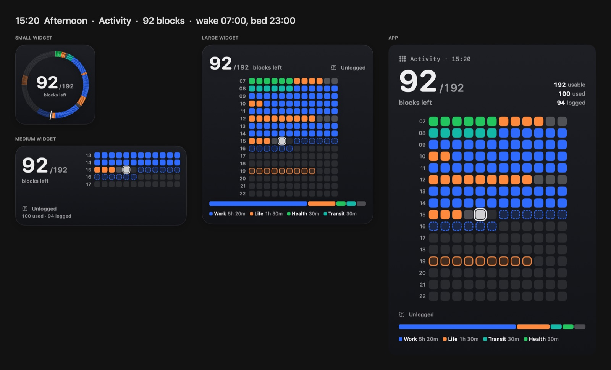
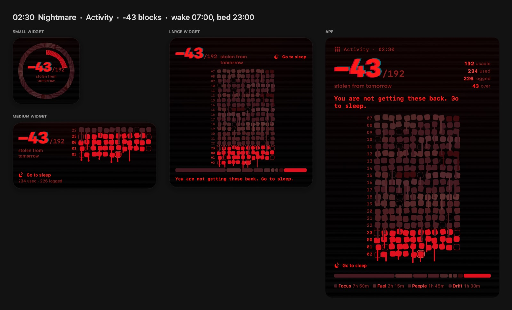
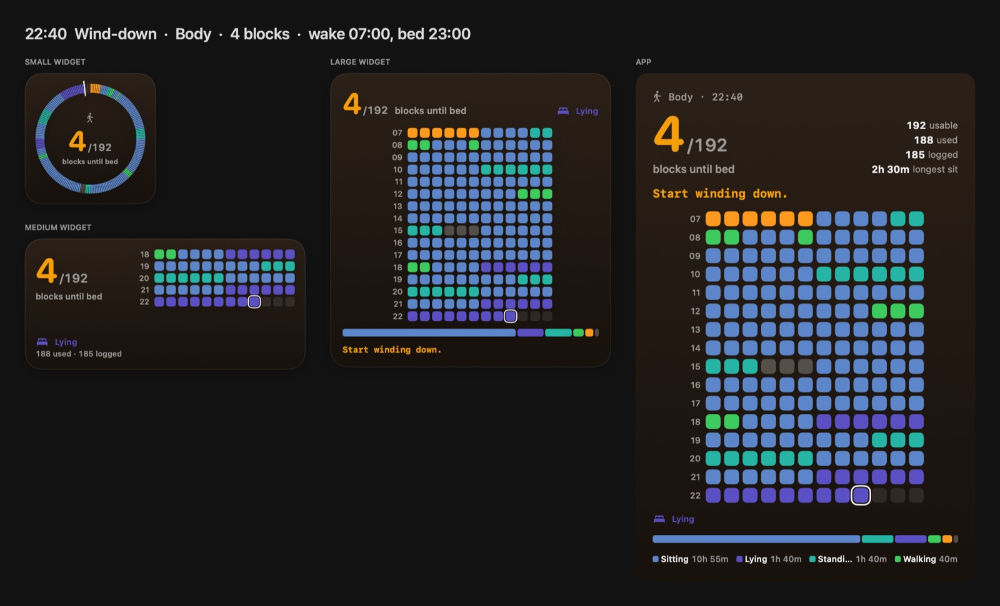

# Time Block

A Mac app and desktop widget that shows your waking day as 5‑minute blocks, so you can *see* time passing,
log what each block went to, and get pushed to bed on time. After bedtime the counter goes negative and the
whole UI slowly turns into a horror show.





- **1 block = 5 minutes.** Rows are clock hours of 12 blocks; only your waking hours are shown.
- **Counter:** blocks left over the day's usable total (`92/192`). It goes negative after bedtime.
- **Sleep shift:** in Settings, move bedtime or wake time to a new time a step a night (bedtime 01:00 to 23:00, 30
  minutes a night). Bedtime moves first and the next morning's wake time follows, so you sleep as long. Set the day
  it starts or the day to be there by; each day's grid and counter use that day's times. Slept in? Change today's
  times under Schedule and the shift carries on from them, Hold Tonight puts each step a night later, and Edit
  changes the rest of the shift.
- **Colors tell the story:** log detailed activities (Breakfast, Email, Gym…); each belongs to a group (Work,
  Learn, Health, People, Life, Transit, Leisure, Drift) and takes its color. Grey is unlogged, red is taken
  from sleep.
- **Views:** switch between Activity and Body (lying, sitting, standing, walking, exercising). Each view is its
  own track of logs, so a block can be *Meeting* and *Standing* at once.

See [PLAN.md](PLAN.md) for the full design, decisions and milestones.

## Status

Built: Mac app window with settings in a side panel (gear button or ⌘,), menu bar extra, and a WidgetKit widget
in three sizes. Logs are saved one file per day. Next up is a nudge for unlogged time; see the milestones in
PLAN.md.

### Logging

- **Hover** a block to see its time and what it holds. A logged stretch (or an unlogged gap) is outlined as a whole,
  with its range: `18:20–19:25 · Social · 1h 5m`.
- **Select, then pick:** click a block to select its whole stretch, double‑click to select just that block, or
  drag to select exactly what you cover. Click an activity under the grid to log the selection, or Clear to empty
  it. The selection stays, and its activity stays lit, until you click off the blocks.
- **Pick, then paint:** with nothing selected, click an activity and drag across blocks. It is put down after one
  drag, so a stray click never logs anything.
- **Find any activity:** the chips are your starred activities, by group. Type in the search field above them to
  find any of the ~170 built in (`meal` finds Breakfast, Lunch, Dinner…); Return picks the top match. Right‑click a
  chip to star or unstar it.
- **Notes:** with logged blocks selected, type a note under the activities (`Dinner with Ana`). It shows when you
  hover them, and a noted stretch is selected and outlined on its own.
- **Menu bar:** one click logs the block in progress, optionally filling the unlogged gap before it.
- **Routine:** in Settings, add what comes back on given days (Lunch 12:00–12:30, weekdays). Each of those days
  it's pre‑logged in whatever blocks are free: hollow until the time comes, then logged, unless you paint over it.
  Change or pause one, and only the blocks still to come move.
- **Settings:** browse the whole library by group, one open at a time, to star more. Edit any activity (name,
  group, and an icon from a searchable picker: `meal` finds the fork and knife) or group (name, color), built-in
  ones too (Reset puts them back, and a name left empty goes back by itself), and add your own groups and
  activities. New ones start unstarred. Remove any activity you don't use: blocks already logged keep it, and
  Removed, at the end of the library, puts it back (still starred, if it was).

## Layout

```
TimeBlockPackage/          Swift package, shared by everything
  TimeBlockKit/            model and block math (pure Foundation, unit-tested)
  TimeBlockUI/             SwiftUI views: grid, ring, counter, mood themes, widget content
  TimeBlockPrototype/      design playground with a time slider; also renders PNGs
TimeBlock.xcodeproj        Mac app + widget extension, depends on the package
TimeBlockApp/              app target sources
TimeBlockWidget/           widget extension sources
Config/                    entitlements, widget Info.plist
```

## Build and run

Requires Xcode 26 and macOS 14 or later.

Run the tests:

```bash
swift test --package-path TimeBlockPackage
```

Build and launch the Mac app (or open `TimeBlock.xcodeproj` and press Run):

```bash
xcodebuild -project TimeBlock.xcodeproj -scheme TimeBlock -derivedDataPath .build/xcode build && open .build/xcode/Build/Products/Debug/TimeBlock.app
```

Then add the widget: right‑click the desktop ▸ Edit Widgets ▸ search "Time Block". Edit a placed widget to
choose its view.

Open the design playground, or render every scenario to `renders/`:

```bash
swift run --package-path TimeBlockPackage TimeBlockPrototype
```

```bash
swift run --package-path TimeBlockPackage TimeBlockPrototype --render renders
```

## Signing

The project signs ad‑hoc ("Sign to Run Locally"), which needs no Apple account. Sharing settings between the
app and the widget needs an App Group, and App Groups need an Apple Developer team. Until one is set up, the
widget always shows the default 07:00–23:00 schedule and no logs. To enable it, pick your team for both targets under
Signing & Capabilities and add the App Group `group.dev.timeblock` to both.
